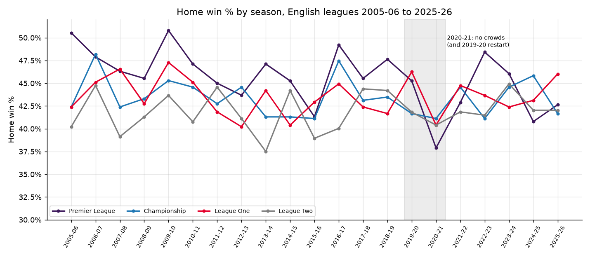
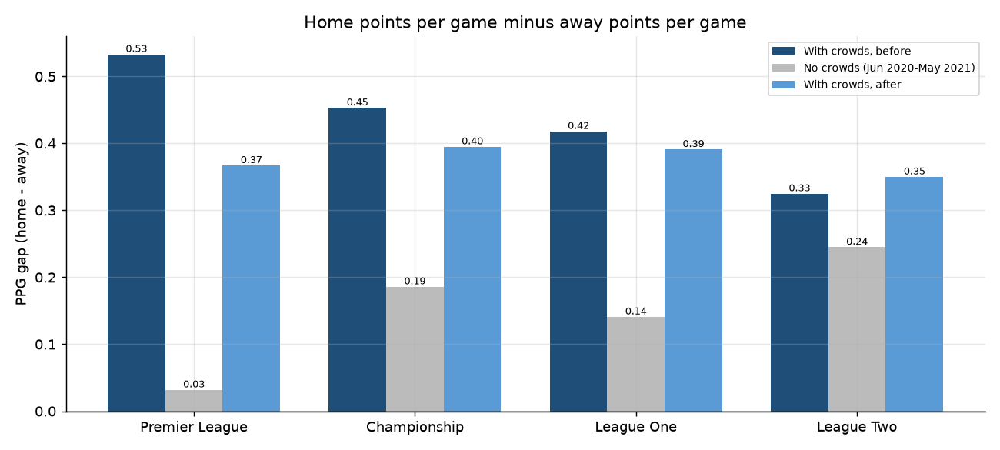
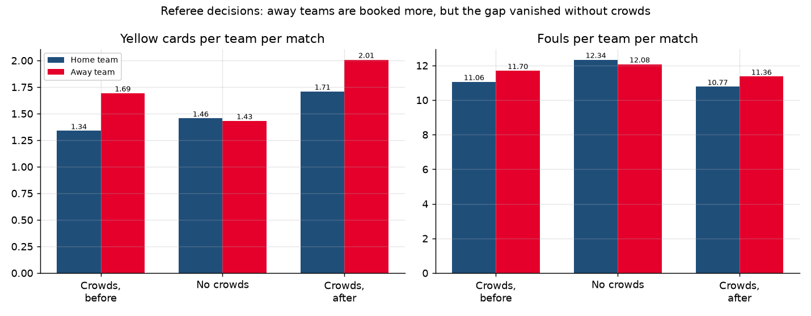
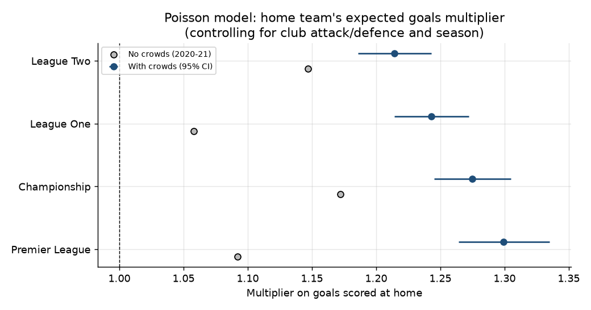
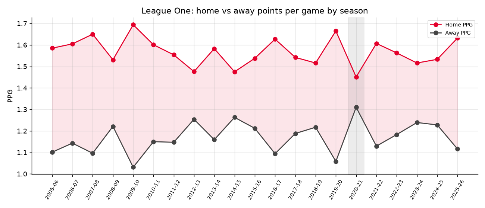
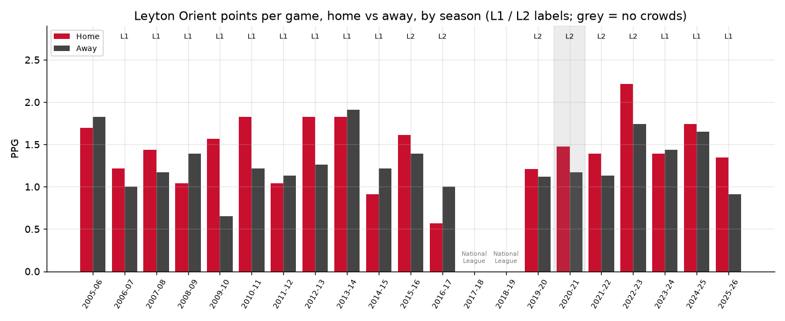
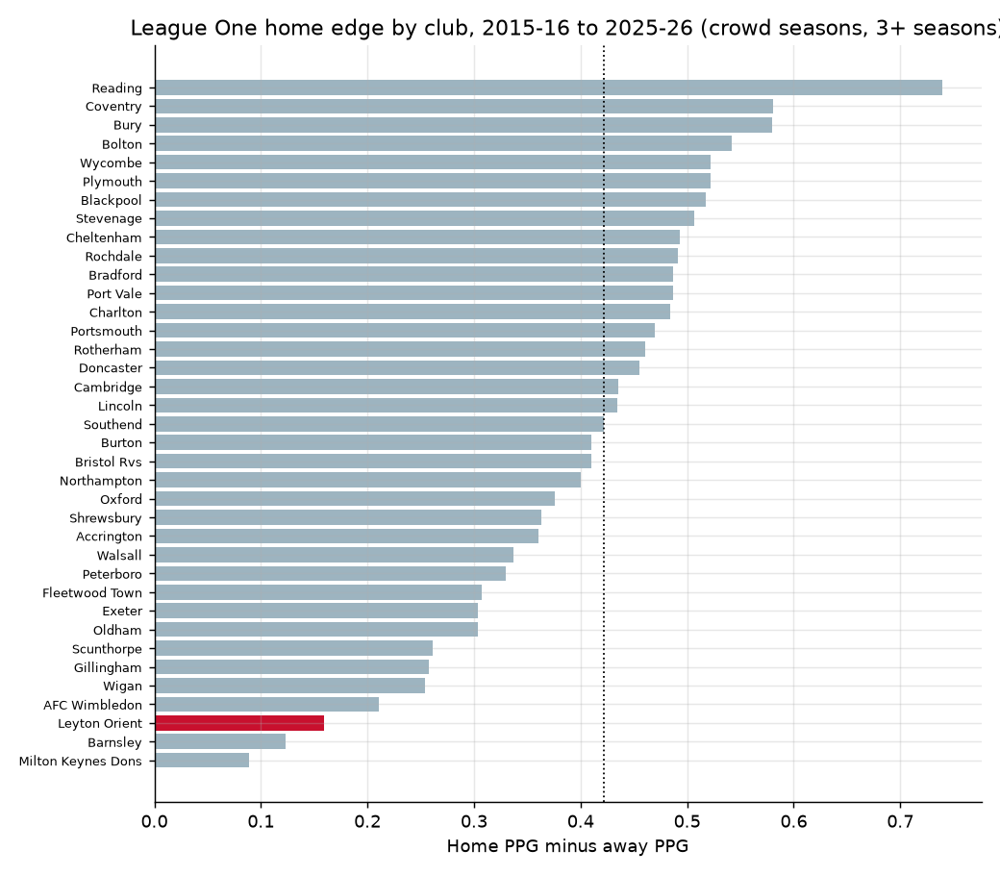

# Home advantage in English football, 2005-06 to 2025-26

How big is home advantage in the Premier League and the EFL, has it changed over 21 seasons, and what happened
when crowds were removed in 2020-21? This project analyses **42,492 league matches** across all four English
divisions (Premier League, Championship, League One, League Two) from Football-Data.co.uk. It uses SQL summaries,
statistical tests, a Poisson goals model and a logistic regression, with a focus on **League One** and a
**Leyton Orient** home vs away case study. It ends with an interactive Streamlit dashboard.

Author: Anthony Adusei-Poku ([@anthony07-max](https://github.com/anthony07-max))



## Key findings

| All four divisions | With crowds | No crowds (Jun 2020 to May 2021) |
|---|---|---|
| Matches | 40,256 | 2,236 |
| Home win % | **43.6%** | **40.3%** |
| Away win % | 29.9% | 35.1% |
| Home PPG minus away PPG | **0.41** | **0.16** |
| Mean home goal difference | +0.30 | +0.13 |
| Away minus home yellow cards per match | +0.30 to +0.36 | **-0.02** |

1. **Home advantage is real and stable.** With crowds, home teams won 43.6% of matches and took 0.41 more points
   per game than away teams. Before COVID, home win % showed no significant trend (2005-06: 43.3%, 2018-19: 44.0%;
   linear trend p = 0.34). The logistic model's season trend is also flat (odds ratio 0.998 per season, p = 0.32).
2. **Removing crowds cut home advantage by about 60%.** The home-away points gap fell from 0.41 to 0.16 and the
   home win rate fell from 43.6% to 40.3% (chi-square p = 0.002; goal difference Welch t-test p < 0.0001).
   Controlling for league and season, the odds of a home win were **12% lower without crowds** (odds ratio 0.877, p = 0.004).
   Home advantage did not disappear completely: the mean home goal difference was still +0.13 (p = 0.0005).
3. **The Premier League effect was the most dramatic.** The home-away PPG gap fell from 0.53 (before 2020) to
   **0.03** without crowds. Away teams won almost as many points as home teams (1.38 vs 1.41 PPG).
4. **Poisson model.** With club attack/defence and season controls, home teams score **1.30x** the goals in the
   Premier League, 1.28x in the Championship, **1.24x in League One** and 1.21x in League Two. So home advantage gets smaller
   lower down the pyramid. Without crowds the multiplier fell to 1.09x in the Premier League (interaction p = 0.001)
   and 1.06x in League One (p = 0.003). The falls in the Championship (1.17x) and League Two (1.15x) were not significant.
5. **Referees: the card gap vanished.** With crowds, away teams got 0.30 to 0.36 more yellow cards per match than home
   teams and committed more fouls. Without crowds the gap disappeared (1.46 home vs 1.43 away yellows). In League One
   it reversed (+0.35 before, -0.08 without crowds). This is consistent with crowd pressure on officials.
6. **League One focus.** League One home teams won 43.7% with crowds and 40.4% without. The home PPG gap fell from 0.41
   to 0.14. Across 37 clubs with 3+ League One seasons since 2015-16, Reading had the biggest home edge
   (+0.74 PPG) and MK Dons the smallest (+0.09).
7. **Leyton Orient have a weak home edge.** Across 19 seasons in the EFL (818 matches with crowds), Orient took 1.44 PPG
   at home and 1.29 away. That gap of **+0.15** is less than half the league average of +0.37 in the same league-seasons
   (one-sided Mann-Whitney p = 0.07). Orient's League One gap since 2023-24 ranks **35th of 37** clubs. In the no-crowd
   2020-21 season their gap was +0.30 (1.48 home vs 1.17 away), wider than in 13 of their 18 seasons with crowds.

| | |
|---|---|
|  |  |
|  |  |




## Method
- **Data:** one CSV per division per season (E0 to E3, 2005-06 to 2025-26, 84 files). These are combined into one
  match table with results, half-time score, shots, corners, fouls, cards and referee. Betting odds are dropped.
- **No-crowd period:** matches from 1 June 2020 to 31 May 2021. This covers the Premier League and Championship
  2019-20 restart and the whole 2020-21 season in all four divisions (2,236 matches).
- **SQL:** season x league summaries (home/draw/away %, PPG, goal difference, cards, fouls) are computed with SQLite.
- **Tests:** chi-square on home win vs not (crowd vs no crowd), a Welch t-test on goal difference, a Wilcoxon
  signed-rank test on paired home/away yellow cards, and a linear trend in pre-2019 home win %.
- **Poisson GLM** (one model per division): `goals ~ home + home:no_crowd + attack(club) + defence(opponent) + season`.
  `exp(home)` is the home goals multiplier.
- **Logistic regression:** `home_win ~ no_crowd + division + season_index`.
- **Club home edge:** home PPG minus away PPG in League One, 2015-16 to 2025-26 seasons with crowds, for clubs with at least 69 home games.

## Data source and licence
- [Football-Data.co.uk, England football results](https://www.football-data.co.uk/englandm.php). Historical results and match
  statistics are provided free by Football-Data.co.uk ([notes on columns](https://www.football-data.co.uk/notes.txt)). All credit for
  collecting the data goes to them. Raw files are not stored in this repo: `src/download.py` fetches them from the source.
  `data/processed/` holds a derived match table (results and match stats only, no odds) and summary tables.
- This project is for analysis and education only. It is not a betting tool.

## Project structure
```
src/download.py      # fetches 84 season CSVs into data/raw/
src/clean.py         # combines them into data/processed/matches.csv
src/analysis.py      # SQL summaries, tests, Poisson + logistic models, charts, key_findings.json
app/streamlit_app.py # interactive dashboard
charts/              # PNG outputs
data/processed/      # tidy CSVs used by the dashboard
```

## How to run
```bash
python -m venv .venv && source .venv/bin/activate
pip install -r requirements.txt
./run_pipeline.sh                      # download, clean, analyse (the Poisson models take a few minutes)
streamlit run app/streamlit_app.py     # dashboard at http://localhost:8501
```

## Limitations
- "No crowds" is not perfectly clean. Small, capped crowds were allowed at some grounds for a few weeks in
  December 2020 and again from 17 May 2021. These matches are still counted as no-crowd.
- 2020-21 had other unusual features: a compressed fixture list, five substitutes in some competitions, and COVID
  absences. Not all of the change can be blamed on the missing crowds.
- 2019-20 League One and League Two were curtailed in March 2020 and decided on points per game, so those seasons are shorter.
  Play-off matches are not in the data.
- Leyton Orient were in the National League in 2017-18 and 2018-19. Those seasons are outside the E0 to E3 files and are not included.
- Club attack and defence are pooled across seasons in the Poisson model (season effects are included). Team-season
  effects would be more precise but much slower to fit.
- Club-level home edges come from fairly small samples (69 to 250 home games) and are noisy.
